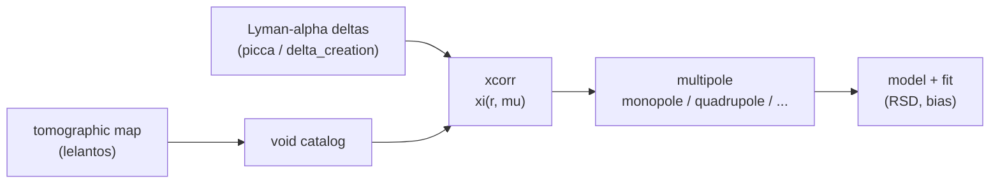

# lyavoid

**lyavoid** computes the **cross-correlation between the Lyman-alpha forest and
the voids** detected in 3-D tomographic maps (voids from the
[lelantos](https://github.com/corentinravoux/lelantos) package), and models its
redshift-space multipoles.

It lets you:

- build picca-style **delta** line-of-sight files from a tomographic
  matter-density cube ([`delta_creation`](api/delta_creation.md));
- compute the **void x forest cross-correlation** `xi(r, mu)` (or in
  `(r_parallel, r_transverse)`) with picca or a built-in estimator
  ([`xcorr`](api/xcorr.md)), and the forest **auto-correlation**
  ([`autocorr`](api/autocorr.md));
- decompose it into **Legendre multipoles** — monopole, quadrupole,
  hexadecapole — with several integration schemes, and plot wedges and 2-D maps
  ([`multipole`](api/multipole.md), [`xcorr_objects`](api/xcorr_objects.md));
- **model and fit** the cross-correlation with simple linear RSD models
  ([`model`](api/model.md));
- drive the whole run from a single `.ini` file ([`interface`](api/interface.md)).

## Where lyavoid sits

lyavoid is a **Pillar 2** (estimators) analysis package. It consumes voids from
tomographic maps (produced by `lelantos`) and Lyman-alpha deltas (from
[picca](https://github.com/igmhub/picca)) and produces a measured cross-
correlation and its multipoles.

## Next steps

- [Getting started](getting-started.md) — install and compute a first correlation.
- [Analysis pipeline](pipeline.md) — the correlation → multipole → fit flow.
- [API reference](api/index.md) — every module, class and function.

!!! note "Conventions"
    Separations `r` are in `h⁻¹ Mpc`; `mu = r_parallel / r`. The
    [`CrossCorr`](api/xcorr_objects.md) object stores `xi` on an `(r, mu)` grid
    (or `(r_transverse, r_parallel)`), and [`Multipole`](api/xcorr_objects.md)
    stores its Legendre poles.
