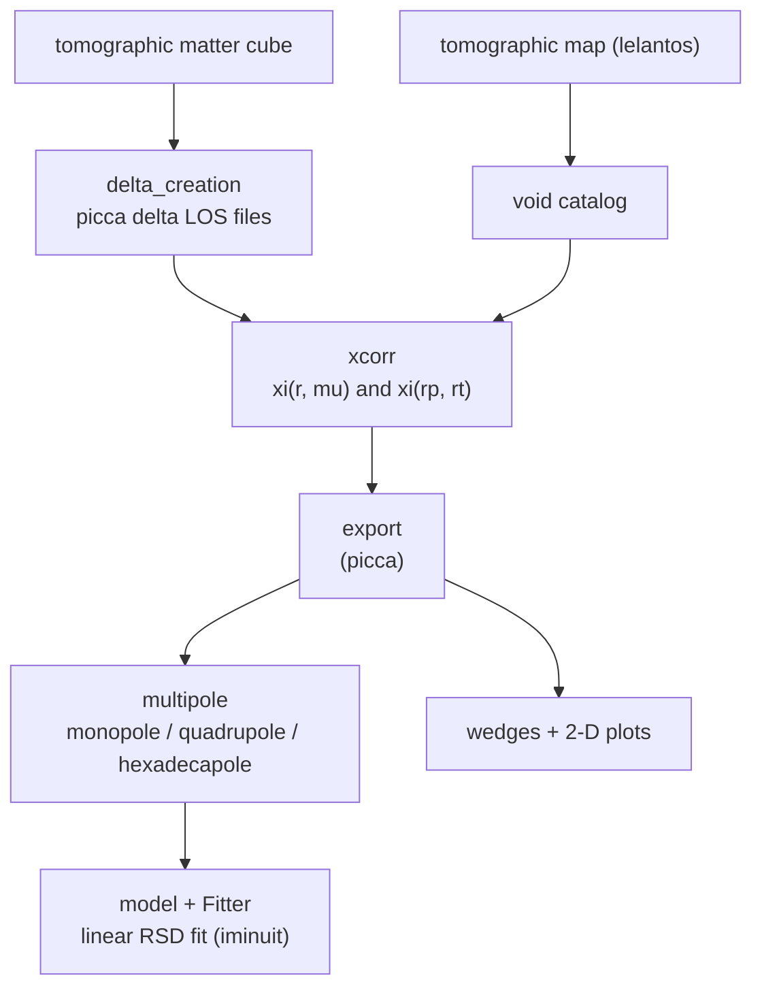

# Analysis pipeline

lyavoid turns a **void catalog** (from a tomographic map) and **Lyman-alpha
deltas** into a measured **void x forest cross-correlation** and its
**multipoles**, optionally fitting a linear model.

## Stages

| Stage | Module | What it does |
|---|---|---|
| **Delta creation** | [`delta_creation`](api/delta_creation.md) | Build picca-style delta line-of-sight files from a tomographic matter-density cube (uses `lelantos` map/pixel objects). |
| **Cross-correlation** | [`xcorr`](api/xcorr.md) | Pair voids with forest deltas and bin the weighted correlation in `(r, mu)` or `(r_parallel, r_transverse)`, then export it (picca). |
| **Auto-correlation** | [`autocorr`](api/autocorr.md) | Forest delta x delta auto-correlation in cartesian `(r_par, r_trans)`, with a numba-accelerated pair loop. |
| **Multipoles** | [`multipole`](api/multipole.md), [`xcorr_objects`](api/xcorr_objects.md) | Project `xi(r, mu)` onto Legendre poles (several integration schemes), with error bars from sub-samples and stacks. |
| **Data objects** | [`xcorr_objects`](api/xcorr_objects.md) | `CrossCorr` (2-D correlation, FITS I/O, plots, `(r,mu)`↔`(rt,rp)` switch) and `Multipole` (poles, FITS I/O, rebuild a correlation from a pole). |
| **Model + fit** | [`model`](api/model.md) | Simple linear RSD/bias models of the correlation and an iminuit `Fitter` for the monopole+quadrupole. |
| **Orchestration** | [`interface`](api/interface.md) | Run the whole computation and plotting from one `.ini` file. |

## Coordinate & unit conventions

- Separations `r` in `h⁻¹ Mpc`; `mu = r_parallel / r`.
- A [`CrossCorr`](api/xcorr_objects.md) stores `xi`, `r_array`, `mu_array` and
  `z_array` on the same `(n_r, n_mu)` grid. The `rmu` flag selects the
  `(r, mu)` vs `(r_transverse, r_parallel)` parameterisation; `switch()`
  converts between them.
- `exported=True` marks a picca-exported 2-D correlation; `exported=False` marks
  a per-subsample stack (3-D `xi`) from which errors are derived.

## Multipole integration methods

`rect` and `nbody` are rectangle rules; `simps`/`trap` use SciPy quadrature;
`rebin_simps`/`rebin_trap` first interpolate `xi(mu)` onto a dense uniform grid;
`quad`/`romb` use adaptive/Romberg integration of an interpolant. `mu` is
optionally extrapolated to the endpoints `±1` before integrating.
